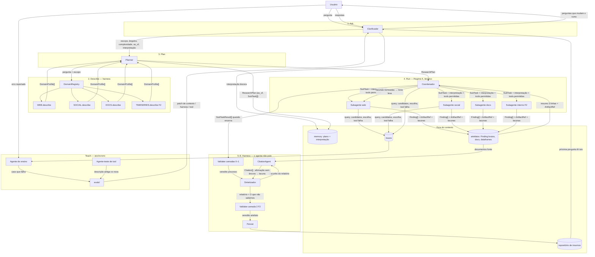
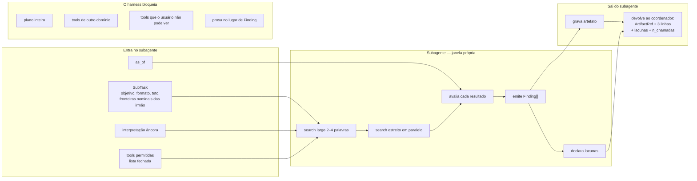
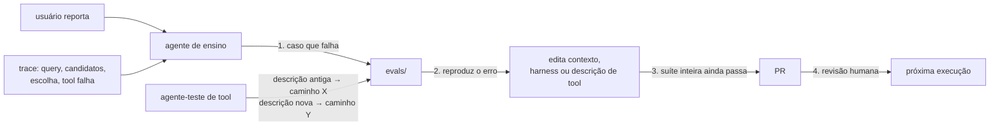
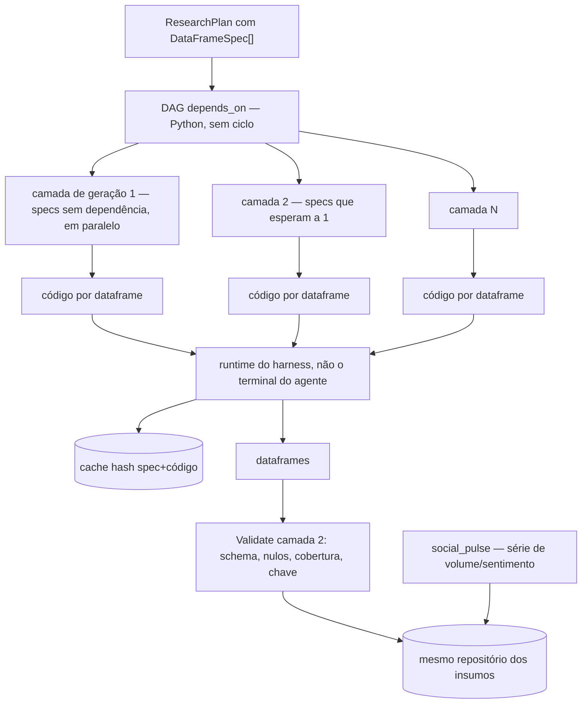

# Plano de construção — sistema de agentes de pesquisa (damas)

**Base:** fork de `alejandro-ao/open-deep-research-w-firecrawl` (smolagents + Firecrawl MCP)
**Referências:** *How we built our multi-agent research system* (Anthropic, jun/2025) e *How Bridgewater Engineers a Research Agent* (PAT, jul/2026)
**Alvo:** pesquisa sobre dados internos estruturados
**Estado atual:** apenas coleta web/texto

A ordem foi escolhida para que nada construído agora precise ser refeito quando os dados internos e as redes sociais entrarem.

---

## 1. Diagnóstico

A base atual é um pipeline linear de um tiro: `planner` → `task_splitter` → `coordinator` dispara subagentes → síntese em markdown. Isso corresponde ao esqueleto da arquitetura orquestrador-trabalhador, mas falta tudo que os dois materiais identificam como o trabalho de verdade — que, como diz o próprio artigo do PAT, é majoritariamente engenharia, não modelo.

O coordenador de hoje ainda carrega um molde de tutorial (temas de "insecurity", "state capacity") e manda o plano inteiro para cada subagente. Os dois efeitos distorcem o relatório e recriam o telefone sem fio que a Anthropic pede para cortar.

| Lacuna | Hoje | Alvo |
|---|---|---|
| Clarificação | query direta → plano | passo **Ask**: escopo, boas perguntas, ângulos, plano acordado |
| Recuperação | Firecrawl genérico | inspeção de domínio sobre RAG/re-ranking — 50% → 90% de acerto |
| Especificação de subtarefa | prompt curto do splitter | objetivo, formato de saída, ferramentas permitidas, fronteiras nominais |
| Orçamento | fixo/implícito | escala com complexidade (1 agente / 3-10 chamadas → 10+ agentes) |
| Paralelismo | sequencial: o coordenador espera cada `initialize_subagent` | mecanismo de desempenho, não polish: 3–5 subagentes + 3+ tools por subagente |
| Citação | lista de URLs no markdown | passo **Cite** separado: cada afirmação do relatório ancorada num `locator` |
| Validação | nenhuma | duas coisas distintas: checagens de *processo* (sempre) e DAG de *artefato* (só F2) |
| Recorte temporal | nenhum | `as_of` no plano; fontes posteriores à data não entram como evidência |
| Permissão | todos os agentes compartilham todas as tools | harness: cada subagente só vê o contexto e as tools do seu domínio e do usuário |
| Memória | `research_result.md` | saída volta ao mesmo repositório dos insumos; uma análise vira entrada da próxima |
| Avaliação | nenhuma | ~20 queries reais + LLM-as-judge com rubrica, incluindo point-in-time |
| Ergonomia de ferramenta | descrição estática | agente-teste usa a tool dezenas de vezes e reescreve a descrição a partir das falhas |
| Fontes | só web | web + docs + **social** + séries/tabelas internas, sob a mesma interface |

---

## 2. Arquitetura alvo

```
pergunta
   ↓
[Ask] clarificador ──────────► escopo, ângulos, complexidade, as_of  (acordado com o usuário)
   ↓
[Describe] inspeção de domínio ► perfil de cada fonte disponível
   ↓
[Plan] planner ──────────────► ResearchPlan tipado, subtarefas sem sobreposição
   ↓
[Run] coordenador ───────────► levas de 3-5 subagentes em paralelo, orçamento por subtarefa
   │                              cada subagente chama 3+ tools em paralelo
   │                              ├── subagente web
   │                              ├── subagente social
   │                              ├── subagente docs
   │                              └── subagente dados internos   (Fase 2)
   │                                  ↳ gravam artefatos fora do contexto,
   │                                    devolvem referência + resumo de 3 linhas
   │                              ↳ o coordenador lê os resumos e decide:
   │                                encerrar  ou  mais uma leva com lacunas nomeadas
   ↓
[Validate] Python comum ──────► camadas 0–1 sempre (processo); camada 2 só F2 (artefato)
   ↓
[Cite] CitationAgent ─────────► percorre o relatório e ancora cada afirmação num locator
   ↓
[Synthesize] relatório + seção "o que não sabemos"
   ↓
[Persist] volta ao mesmo repositório dos insumos
   ↑
[Teach] erro reportado → benchmark que falha → edita contexto/harness/descrição de tool → PR
```

Dois tipos de paralelismo, os dois desde o primeiro Run que funcionar: (1) o coordenador dispara a leva inteira de uma vez, não um subagente por vez; (2) cada subagente dispara buscas independentes juntas. Na Anthropic isso cortou até 90% do tempo em consultas complexas. Sem os dois, o sistema paga o custo de 15× uma conversa e colhe o throughput de um agente só.

---

## 2.1 Dois grafos, dois regimes

A Anthropic diz que pesquisa é path-dependent e **não** cabe num caminho fixo. O PAT diz que o plano é um DAG e a validação é compilador. Os dois estão certos em domínios diferentes. O plano trata isso como dois regimes no mesmo sistema, não como um slogan só.

**Regime A — processo (web, social, docs; Fase 1).** O grafo é do *ciclo de pesquisa*: Ask → Describe → Plan → Run iterativo → Validate → Cite. O coordenador **precisa** poder abrir outra leva. O prompt "chame exatamente uma vez por subtarefa" do código atual impede isso e deve sair. Validação aqui é estrutural (camadas 0–1): toda afirmação tem fonte, toda subtarefa devolveu achado ou lacuna, orçamento respeitado, corroboração cruzada. Não tente transformar busca web num DAG de tarefas com schema — não há schema de "correto" nesse domínio, e engessar perde o que a Anthropic mede (adaptar à descoberta).

**Regime B — artefato (séries e tabelas internas; Fase 2).** O grafo é do *produto*: dataframes com schema, `depends_on`, geração paralela, cache por hash. Validação aqui é a camada 2, em Python, nunca pulável. O agente não decide se valida.

Regra prática: o loop iterativo é obrigatório na Fase 1; o DAG de dataframes só existe na F2. Misturar os dois — DAG de tarefas web, ou validação "o agente decide" sobre series internas — reproduz o modo de falha de cada paper no domínio errado.

---

## 3. Migração arquivo a arquivo

| Repo base | Vira | O que muda |
|---|---|---|
| `prompts.py` | `prompts.py` | reescrito: clarificador, planner com perfis de domínio, coordenador com decisão binária e permissão de nova leva, subagente com contrato completo (sem o plano inteiro), sintetizador, citation agent, juiz |
| `task_splitter.py` | `planner.py` | emite `ResearchPlan` tipado; o "split" deixa de ser passo separado |
| `planner.py` | `clarifier.py` | vira o passo Ask |
| `coordinator.py` | `coordinator.py` | dispara a **leva** em paralelo; subagentes recebem `SubTask` e só as tools do domínio; devolvem `SubTaskResult`; loop com decisão de nova rodada |
| — | `contracts.py` | **novo** — tipos |
| — | `sources.py` | **novo** — domínios com `describe/search/fetch` |
| — | `validation.py` | **novo** — checagens de processo (0–1) e, na F2, DAG de artefato |
| — | `citations.py` | **novo** — CitationAgent; não é um campo do `Finding` |
| — | `memory.py` | **novo** — plano e artefatos fora do contexto |
| — | `evals/` | **novo** — 20 queries + juiz, incluindo point-in-time |
| `main.py` | `main.py` | orquestra: clarify → describe → plan → run → validate → cite → synthesize → persist |

---

## 4. Contratos

Os tipos abaixo são o que impede o sistema de precisar ser reescrito. Campos marcados **[F2]** já existem, ficam opcionais enquanto só houver web/social, e passam a obrigatórios com os dados internos.

**`SubTask`** — objetivo (uma frase, imperativo), formato de saída exato, domínios permitidos, **ferramentas permitidas** (lista fechada; o harness recusa o resto), fronteiras que citam nominalmente as subtarefas irmãs, critérios de sucesso verificáveis, teto de chamadas, **[F2]** dataframes que produz. O subagente **não** recebe o `ResearchPlan` inteiro — recebe este contrato e, se o contexto truncar, a `interpretação` âncora. Fronteiras nominais bastam para não duplicar a irmã; o plano completo recria o telefone sem fio.

**`ResearchPlan`** — pergunta original, escopo acordado, interpretação (âncora quando o contexto for truncado), ângulos considerados incluindo os descartados, complexidade, **`as_of`** (data-limite da evidência; omitida = agora), subtarefas.

**`Finding`** — afirmação + pelo menos uma `SourceRef` + nível de confiança + ressalvas. Subagente devolve isto, nunca prosa. Hoje parece burocracia sobre um resultado de busca; quando o subagente devolver um dataframe em vez de um parágrafo, o coordenador não muda uma linha. Ter `SourceRef` no achado **não** substitui o passo Cite: o sintetizador ainda pode escrever prosa convincente com bibliografia decorativa.

**`SourceRef`** — domínio, `locator`, título, data de coleta, **data de publicação** (quando houver; é o que o recorte `as_of` consulta), qualidade (primary/secondary/unknown). O `locator` é agnóstico: serve para URL, id de post, id de série temporal ou caminho de arquivo.

**`ArtifactRef`** — subtarefa, tipo, caminho, resumo de até 3 linhas. Saída longa vai para disco; o coordenador lê o resumo. Isso corta o telefone sem fio e o custo de copiar tudo pelo histórico.

**`SubTaskResult`** — achados, artefatos, **lacunas declaradas**, chamadas usadas. A lacuna declarada é o que permite ao coordenador decidir por outra rodada sem inventar achado.

**`Citation`** — afirmação do relatório final + `SourceRef` + trecho âncora no documento fonte. Produzido pelo CitationAgent, não pelo sintetizador e não pelo subagente. Se uma afirmação não ancora, ela cai para "O que não sabemos" ou some do relatório — nunca fica como fato órfão.

### Orçamento por complexidade

| Complexidade | Subagentes | Chamadas/subagente | Total | Paralelismo |
|---|---|---|---|---|
| `lookup` | 1 | 5 | 5 | 1 |
| `comparison` | 4 | 12 | 48 | 4 |
| `exploratory` | 6 | 15 | 90 | 4 |
| `deep` | 12 | 20 | 240 | 5 |

Agentes não julgam bem o esforço adequado, então a regra vai no código e no prompt do coordenador. Gastar todo o orçamento numa pergunta simples é o modo de falha mais comum das primeiras versões.

O orçamento também é o teto de **tokens**, não só de chamadas. Na análise da Anthropic, uso de tokens sozinho explica ~80% da variância no BrowseComp; número de tool calls e escolha de modelo explicam o resto. Multiagente ganha porque cada subagente tem janela própria — isso *é* o mecanismo, não um efeito colateral. Sem paralelismo real, aumentar o orçamento só alonga uma fila sequencial.

---

## 5. Domínios de fonte

Esta é a peça que decide se você reescreve o sistema quando os dados internos chegarem. Todo domínio expõe três operações:

```
describe(pergunta) -> DomainProfile   # o que existe aqui dentro
search(query, limite) -> [Candidate]
fetch(locator) -> (conteudo, SourceRef)
```

O `describe` é a **inspeção de domínio** — o passo que levou a recuperação do PAT de ~50% para ~90%. O agente inspeciona a estrutura da fonte *antes* de buscar, em vez de jogar a query direto num índice vetorial. O `DomainProfile` devolve: o que existe, a estrutura (taxonomia, schemas, convenções de nome), dicas de como se busca bem naquele domínio, e as lacunas conhecidas.

| Domínio | Status | `describe()` devolve |
|---|---|---|
| `WEB` | implementar agora | busca larga de reconhecimento, domínios dominantes no tema, heurística de fonte primária |
| `SOCIAL` | seção 6 | plataformas cobertas, janela disponível, contas/hashtags relevantes, limites de taxa |
| `DOCS` | conforme necessidade | taxonomia real do acervo, não um chute do modelo |
| `TIMESERIES` | **[F2]** | catálogo filtrado pela pergunta: convenções de nome, frequência, unidade, janela, interna vs externa |
| `TABULAR` | **[F2]** | schemas, chaves, cardinalidade |

Um `DomainRegistry` é a única coisa que o coordenador conhece. Adicionar fonte nova é uma linha.

**Permissão é harness, não prompt.** No PAT, cada usuário vê um agente diferente só pelo contexto carregado e pelas tools expostas. Consequência aqui: o subagente web não recebe a tool do banco; o de dados internos não recebe Firecrawl; nenhum recebe uma tool que o usuário da sessão não pode ver. O modelo pode ser instruído a respeitar o limite — o harness é o que o impõe. Quando a F2 entrar, isso deixa de ser detalhe e vira fronteira de vazamento.

> **Descrição de ferramenta ruim manda o agente pelo caminho errado.** Trate as descrições de domínio e de ferramenta como código de produção: teste-as, itere nelas. Um agente buscando na web algo que só existe no banco interno está condenado desde o início.

A Anthropic mediu 40% a menos de tempo de conclusão depois que um agente-teste usou uma MCP tool falha dezenas de vezes e reescreveu a descrição. Isso entra no loop de ensino (seção 11), não como nota de rodapé: falha de tool → o caso de eval inclui a descrição antiga → a descrição nova é o patch.

---

## 6. Agentes de redes sociais

Redes sociais entram como **mais um domínio** — mesma interface `describe/search/fetch`, mesmo contrato de `SubTask`, mesmo `Finding`. Mas elas têm três características que exigem tratamento próprio: o acesso é caro e restrito, o dado é sujo de uma forma específica, e o tratamento é regulado.

O sprint de social só começa depois que o coordenador já fala a língua `Finding` / `ArtifactRef` / lacuna declarada, dispara levas em paralelo e passa pelo Cite. Senão você especializa quatro subagentes sobre um contrato que ainda é markdown.

> **Nota:** esta seção contém números de mercado coletados em agosto/2026 e uma leitura não jurídica da LGPD. Preços de API mudaram várias vezes em 2026 e boa parte das compilações públicas é produzida por fornecedores de alternativas — confirme na fonte antes de orçar. A parte de conformidade precisa passar pelo jurídico antes da primeira linha de código.

---

### 6.1 O que dado social é e o que não é

Um post quase nunca é fonte primária de um **fato**. Ele é fonte primária do **fato de que alguém disse aquilo**. Essa distinção precisa estar no prompt do subagente e na rubrica do juiz, ou o sistema relata boato como achado — o erro mais caro que um sistema de pesquisa que alimenta decisão pode cometer.

| Tipo de afirmação | Confiança máxima | `SourceRef.quality` |
|---|---|---|
| Fato sobre o mundo, extraído de post | `low`, exige corroboração em outro domínio | `secondary` |
| Sentimento, volume, narrativa, timing | `high` — aqui a rede social é a fonte certa | `secondary` |
| Declaração oficial da conta que é o próprio sujeito da pergunta | `high` | `primary` |

---

### 6.2 Os três caminhos de acesso

A intuição de "é só raspar" está desatualizada. As plataformas fecharam o acesso gratuito entre 2023 e 2026.

#### Caminho A — API oficial

Único caminho que não coloca a operação em conflito com termos de uso. É o mais caro.

**X (Twitter).** Desde fevereiro/2026 o padrão para novos desenvolvedores é pagamento por uso: cerca de US$ 0,005 por leitura de post, sem mínimo mensal, com teto de 2 milhões de leituras/mês. O tier gratuito foi descontinuado e Basic/Pro estão fechados para novas assinaturas. Na prática, 10 mil posts lidos custam ~US$ 50. **A limitação que mata projetos de pesquisa:** busca no arquivo completo e acesso a streams ficaram restritos a Pro e Enterprise, e o acesso acadêmico foi descontinuado. Dados históricos praticamente exigem contrato Enterprise (reportado a partir de ~US$ 42 mil/mês).

**Reddit.** Gratuito a 100 requisições/minuto para uso **não comercial**. Uso comercial exige aprovação manual e contrato — e o self-service foi fechado no fim de 2025, com a aprovação correndo por uma fila de tickets lenta e opaca; uma parcela relevante de projetos legítimos de leitura é rejeitada ou ignorada. Um sistema interno de pesquisa de uma empresa cai do lado comercial da linha. Planeje semanas de espera. Limitação estrutural relevante: a busca não tem filtro por intervalo de datas.

**Meta, TikTok, LinkedIn.** Acesso a dados públicos para pesquisa é restrito ou inexistente sem programa específico. Trate como indisponível até prova em contrário.

#### Caminho B — provedor terceiro (recomendado para começar)

Empresas que já resolveram a coleta e vendem os dados por API. Preço em ordens de magnitude menor, integração trivial.

O que você herda junto: o risco de conformidade do fornecedor. Se o provedor coleta de forma que viola os termos da plataforma, seu fornecimento pode desaparecer de um dia para o outro, e a exposição não fica inteiramente com ele. Trate como fornecedor sujeito a due diligence, não como uma URL: verifique origem declarada do dado, política de retenção, e o que acontece com o seu contrato se a plataforma bloqueá-lo.

#### Caminho C — scraping próprio

O difícil não é escrever o extrator — Firecrawl ou Playwright resolvem isso em uma tarde. O difícil é que **scraping é um sistema de manutenção permanente**, não um componente que se constrói e esquece:

- o HTML muda sem aviso e quebra o extrator em silêncio (pior que quebrar com erro)
- as plataformas detectam e bloqueiam tráfego automatizado
- a maior parte do conteúdo social hoje exige login, o que sai de "ler página pública" e entra em quebra de termos de uso
- o custo real não é de infraestrutura, é de uma pessoa mantendo isso indefinidamente

Para o damas, o Caminho C só se justifica se A e B forem inviáveis para uma fonte específica e insubstituível — e mesmo aí, com parecer jurídico.

---

### 6.3 Conformidade — LGPD e termos de uso

**Dado público continua sendo dado pessoal.** A ANPD formalizou no Radar Tecnológico nº 3 (nov/2024) que web scraping constitui tratamento de dados pessoais e está sujeito à LGPD, mesmo quando o dado foi publicado voluntariamente pelo titular. A raspagem entrou na agenda regulatória e de fiscalização da Autoridade.

**Finalidade importa.** Informação em perfil público usada para finalidade que o titular não esperava — formação de perfis comerciais, por exemplo — pode violar direitos dele se não houver transparência sobre coleta e finalidade. A dispensa de consentimento para dados manifestamente tornados públicos pelo titular não dispensa a existência de uma base legal válida para o tratamento.

**Exposição contratual é separada.** A maioria das redes proíbe raspagem nos termos de serviço. Isso é risco de quebra de contrato, independente e cumulativo ao risco de LGPD.

#### Decisões a tomar antes do Sprint 8

Estas são muito mais baratas agora do que retrofitadas depois:

1. **Base legal declarada** — qual hipótese do art. 7º sustenta o tratamento, e a finalidade escrita em uma frase. Sem isso, nenhum coletor deveria rodar.
2. **Minimização no `SourceRef`** — coletar e reter o mínimo. Proposta: guardar `locator` (id do post), texto, timestamp e métricas de alcance; **não** guardar nome real, foto, bio, localização ou histórico do autor. Identificador de autor apenas em hash, o suficiente para deduplicar e medir concentração de autoria sem reidentificar.
3. **Política de retenção dos artefatos** — o sistema grava artefatos em disco. Defina prazo de expiração e rotina de expurgo agora, ou você terá um lago de dados pessoais sem dono em seis meses.
4. **Verbatims no relatório** — citação literal de post identificável no relatório final é tratamento adicional. Padrão sugerido: verbatim sem atribuição de autoria, salvo quando a conta for pública/institucional e a autoria for parte do achado.
5. **Trilha de proveniência** — registrar de onde cada item veio (plataforma, provedor, data de coleta, base legal). É o que responde a um questionamento de titular ou fiscalização.
6. **Nada de dado sensível** — saúde, opinião política, religião, orientação sexual, filiação sindical têm regime mais restrito. Se o tema da pesquisa toca nisso, o assunto muda de patamar e precisa de parecer específico.

---

### 6.4 Subagentes propostos

**`social_pulse`** — volume e sentimento sobre um tema numa janela. Saída: contagem por dia, distribuição de sentimento, picos datados. É o subagente que mais naturalmente se conecta à Fase 2: **a saída dele já é uma série temporal** e pode viver no mesmo repositório das séries internas.

**`social_narrative`** — narrativas dominantes e dissidentes. Saída: 3-6 narrativas com verbatims representativos e volume aproximado. Regra de prompt: incluir explicitamente a narrativa minoritária, ou o agente converge para o consenso e some com o sinal interessante.

**`social_actors`** — quem impulsiona a conversa: alcance, quem originou o pico, grau de coordenação aparente. Separa movimento orgânico de amplificação. **Atenção de conformidade:** este é o subagente que mais se aproxima de perfilamento de pessoas. Restrinja a contas institucionais e de alcance relevante, e trabalhe com identificadores hasheados.

**`social_early_signal`** — menções recentes que ainda não chegaram à imprensa. É onde a rede social supera a web: latência. Cruzar com o domínio `WEB` para marcar o que já foi coberto e o que não.

---

### 6.5 O que o `describe()` do domínio social devolve

Sem isto, o subagente busca a hashtag errada com alta confiança:

- plataformas efetivamente acessíveis e janela histórica de cada uma
- contas, hashtags e termos relevantes ao tema, descobertos em sondagem prévia
- idioma e região predominantes do corpus
- limites de taxa e orçamento restantes no período
- lacunas conhecidas: plataforma sem acesso, período sem cobertura, busca sem filtro de data

---

### 6.6 O dado é sujo de forma específica

Esta parte importa mais que a escolha de caminho, e é onde projetos de coleta social decepcionam.

**A amostra nunca é a população.** Toda API devolve uma fatia — os últimos 7 dias, ou o que o ranqueamento por relevância decidiu mostrar. Você quase nunca conhece o denominador. Consequência prática: volume de menções é métrica **relativa** (subiu ou desceu contra a própria série), nunca absoluta. O relatório precisa dizer isso.

**Amplificação infla tudo.** Mil reposts do mesmo conteúdo são um item de evidência, não mil.

**Bots e contas coordenadas.** Em qualquer tema com interesse econômico ou político, parte do corpus é inorgânica. Não é preciso detectar com precisão — é preciso reportar concentração de autoria junto com o achado.

**Análise de sentimento em português é pior do que a literatura sugere.** Ironia, gíria regional e negação derrubam a acurácia. Um LLM lendo 50 posts e resumindo narrativas costuma render mais que um classificador rodando em 50 mil.

---

### 6.7 Checagens de validação específicas

Entram na camada 1 do DAG, junto com as demais:

| Checagem | Regra | Severidade |
|---|---|---|
| corroboração cruzada | afirmação factual com fonte apenas social e sem corroboração em outro domínio não sobe ao relatório como fato | erro |
| deduplicação de amplificação | conteúdo idêntico ou quase idêntico colapsa em um item de evidência | erro |
| densidade temporal | se todos os posts vêm de uma janela de horas, o achado é um pico, não uma tendência; janela declarada no relatório | aviso |
| concentração de autoria | poucas contas respondendo pela maioria dos posts vira ressalva anexada ao achado | aviso |
| denominador desconhecido | volume absoluto sem denominador conhecido não pode ser apresentado como magnitude | erro |
| orçamento e rate limit | chamadas sociais contabilizadas no orçamento da subtarefa; cache por (plataforma, query, janela) | erro |
| minimização | nenhum campo pessoal fora da lista permitida presente nos artefatos gravados | erro |

---

### 6.8 Como começar (recomendação)

Não construa "coleta de redes sociais". Escolha:

- **uma** pergunta do conjunto de eval que só a rede social responde
- **uma** plataforma
- **uma** janela de 30 dias
- um provedor terceiro com crédito de teste, para não gastar semanas em infraestrutura antes de saber se o dado serve

E meça uma coisa só: essa pergunta ficou melhor respondida? Se ficou, aí vale a conversa sobre acesso definitivo — e a decisão entre API oficial e provedor passa a ser tomada com o custo real conhecido, não estimado.

## 7. Validação determinística

Python comum, rodando **fora** do agente. O agente não pode pular, não pode se convencer de que já validou, e não gasta token nisso. Duas execuções do mesmo plano devem produzir o mesmo *veredito de checagem* mesmo que o texto varie.

As camadas 0–1 validam o **processo** (Regime A). Só a camada 2 valida um **grafo de artefatos** (Regime B). Não construa um DAG de subtarefas web com `depends_on` — isso é o Regime B aplicado no lugar errado.

**Camada 0 — integridade estrutural**
- toda afirmação tem pelo menos uma fonte
- toda subtarefa devolveu resultado
- orçamento respeitado, por subtarefa e no total
- nenhuma tool fora da lista permitida da subtarefa foi chamada
- nenhuma `SourceRef` com publicação posterior a `as_of`, quando `as_of` estiver no plano

**Camada 1 — cobertura e qualidade**
- critérios de sucesso endereçados (achados ou lacunas declaradas; silêncio é erro)
- sem trabalho duplicado (mesma fonte usada por subagentes diferentes = plano mal dividido; sinal para o loop de ensino)
- proporção mínima de fontes primárias
- as sete checagens sociais da seção 6.7
- toda afirmação factual que sobreviveu ao sintetizador tem `Citation` (a camada 1 roda de novo depois do Cite, ou o Cite falha fechado)

**Camada 2 — dados internos [F2]**
- cada dataframe bate com o schema fixado no plano (colunas, tipos, índice)
- o grafo de `depends_on` resolve, sem ciclo
- checagens de nulo, cobertura temporal e chave de junção

Se uma camada produz erro, as camadas dependentes são **puladas e reportadas como puladas** — nunca como sucesso.

---

## 7.1 CitationAgent — passo, não campo

`Finding.SourceRef` diz de onde o subagente *acha* que tirou o achado. O CitationAgent diz se o relatório *final* ainda está ancorado. São jobs diferentes, e a Anthropic isolou o segundo num agente com janela própria precisamente porque o sintetizador mistura confiança com correção.

O passo:

1. recebe o relatório do sintetizador e os documentos/artefatos fonte, não o histórico da conversa
2. para cada afirmação factual, localiza o trecho que a sustenta e emite um `Citation`
3. afirmação sem âncora: rebaixa a lacuna ou remove; não deixa passar como fato
4. afirmação cuja única âncora é social, sem corroboração: aplica a regra da seção 6.1

Isso vive em `citations.py` e no grafo do `main.py` **depois** do Validate de processo e **antes** de persistir. Não é um campo a mais no `Finding`. Sem este passo, o erro caro do sistema — boato ou página de SEO relatados como fato — continua possível.

---

## 8. Prompts — princípios

Instalar boas heurísticas, não regras rígidas. Onde houver regra rígida, ela vai no código, porque o agente não consegue pular Python.

**Clarificador** — devolve interpretação, escopo, `as_of` (hoje, ou a data que o usuário pediu), 2-4 perguntas cuja resposta mudaria o rumo (lista vazia se nenhuma mudaria; não inventar pergunta para parecer diligente), 3-5 ângulos incluindo um que o usuário provavelmente não considerou, e a complexidade.

**Planner** — recebe o escopo acordado e os perfis de domínio já inspecionados. Divide por ângulo ou por fonte, nunca repetindo a mesma pergunta. Se duas subtarefas fariam a mesma busca, funde. Usa menos que o teto quando o teto for excessivo. Cada `SubTask` já nasce com a lista fechada de tools.

**Coordenador** — não pesquisa; dispara a leva em paralelo, lê resumos de artefatos (não os artefatos), e decide uma coisa só: encerrar ou mais uma rodada com lacunas nomeadas. Nunca inventa achado para preencher lacuna. Lacuna declarada no relatório vale mais que afirmação sem fonte. **Pode** abrir outra leva — o "exatamente uma vez por subtarefa" do código atual é o bug a apagar. Não recebe e não repassa o plano inteiro aos trabalhadores.

**Subagente** — recebe só o `SubTask`, a interpretação âncora e as tools permitidas. Começa largo (2-4 palavras) e estreita; query longa e específica de primeira quase sempre volta vazia. Chama ferramentas em paralelo quando as buscas são independentes. Avalia cada resultado antes de seguir (pensar *entre* chamadas, não só no começo). Prefere fonte primária a agregador ou conteúdo escrito para ranquear. Recusa evidência posterior a `as_of`. Para quando os critérios de sucesso forem atingidos.

**CitationAgent** — não pesquisa e não reescreve o argumento. Só ancora. Em caso de dúvida, rebaixa; nunca inventa âncora.

**Sintetizador** — responde a pergunta antes de contextualizá-la. Mostra divergências entre fontes em vez de escolher uma. Abre seção "O que não sabemos" com as lacunas — ela é parte do relatório, não uma falha dele. Não usa molde temático de tutorial (nada de "insecurity" / "state capacity" genéricos). O Cite roda sobre a saída dele, não no lugar dele.

---

## 9. Avaliação

20 queries reais em `evals/queries.yaml`, com resposta esperada onde houver uma. Rode no sistema atual e guarde como baseline **antes de mudar qualquer coisa**. Nesta fase, uma mudança de prompt pode mover a taxa de sucesso de 30% para 80% — com efeito desse tamanho, 20 casos bastam para enxergar.

Composição do conjunto:

- metade das queries deve ser do tipo que você *quer* responder com dados internos daqui a alguns meses, mesmo que hoje só dê para atacar pela web. Elas vão ter nota baixa agora, e é essa nota que vai medir o ganho da Fase 2.
- 3–4 queries cuja resposta correta é "não há evidência suficiente". Sistemas de pesquisa alucinam mais nessas do que em qualquer outra.
- 2–3 queries **point-in-time**: a pergunta traz um `as_of` no passado, e a resposta esperada usa só o que existia naquela data. Fonte posterior que vaza para o relatório é falha, mesmo que o fato esteja "certo" hoje. É o teste que o talk do PAT deixa em aberto, e o que separa recuperação fluente de disciplina de pesquisa. Sem isso, o juiz premia o sistema que mais sabe, não o que mais pesquisa.

**Juiz** — uma única chamada de LLM, notas 0.0-1.0 e um passa/falha. Múltiplos juízes especializados soam melhor e alinham pior com julgamento humano. Rubrica: precisão factual, precisão de citação (a âncora existe e sustenta a afirmação), completude, qualidade de fonte, eficiência de ferramenta, **respeito a `as_of`**.

Onde a propriedade for executável (fonte depois de `as_of`, afirmação sem `Citation`, tool fora da lista), o teste em Python é o instrumento — não o juiz. LLM-as-judge fica para o que não tem schema. O PAT chama o resto de "vibes-based"; a ressalva justa é que juiz tem viés de posição, verbosidade e auto-preferência, então use-o só no trecho em que não há alternativa.

**Teste humano continua obrigatório.** Testadores humanos pegam o que a automação não pega — respostas alucinadas em queries incomuns, e viés sistemático de seleção de fonte (o caso clássico: o agente preferindo conteúdo otimizado para busca a PDFs acadêmicos ou blogs pessoais bem informados).

---

## 10. Tokens, paralelismo e confiabilidade

**Tokens são o mecanismo.** Multiagente não ganha porque "vários cérebros pensam melhor"; ganha porque distribui capacidade de contexto. Agentes simples usam ~4× uma conversa; sistemas multiagente, ~15×. Isso só se paga em pergunta cara de responder à mão — daí o orçamento `lookup`. A implicação operacional: paralelismo de leva e de tools entra **junto** com o primeiro Run de verdade, não num sprint de polish no fim. Sem isso, cada melhoria de prompt é medida sobre um sistema que não está exercitando a arquitetura.

O `initialize_subagent` como tool síncrona do coordenador, no código atual, serializa a leva. O alvo é: o harness dispara os N subagentes da leva de uma vez e só então devolve os `SubTaskResult` ao coordenador. Execução síncrona *entre levas* (esperar a leva inteira) é gargalo conhecido e aceitável no começo; assincronia entre levas traz ganho, e também consistência de estado e propagação de erro. Não comece por aí.

**Erros compõem.** Um agente de longa duração que falha no passo 12 não pode recomeçar do zero. Checkpoint por subtarefa, retomada do ponto de falha, retry determinístico. E avisar o agente quando uma ferramenta está falhando — deixá-lo adaptar funciona surpreendentemente bem.

**Tracing.** "O agente não achou o óbvio" é irrespondível sem rastro. Registre qual query foi emitida, quais candidatos voltaram, qual foi escolhido e por quê, e qual ferramenta falhou. Sem monitorar conteúdo de conversa — o que importa são os padrões de decisão. Esse rastro é também o insumo do agente-teste de tools (seção 11).

---

## 11. Loop de ensino

Todo erro reportado percorre, nesta ordem:

1. vira um caso no `evals/` que **falha**
2. edita-se o contexto, o harness **ou a descrição da ferramenta** até passar
3. a suíte inteira continua passando (o patch não pode quebrar o caso da semana passada)
4. abre-se um PR

Três origens, o mesmo pipeline:

- usuário reporta ("perdeu o óbvio", "citou SEO", "usou dado de depois da data")
- trace mostra tool chamada errada ou query que voltou vazia por descrição ruim
- agente-teste de ferramenta: recebe a tool, tenta usá-la dezenas de vezes, reescreve a descrição; o caso de eval é "com a descrição antiga o agente toma o caminho X; com a nova, o Y"

É isso que impede o sistema de regredir nas mesmas coisas e o que transforma reclamação de usuário em ativo permanente. Fecha o ciclo com a seção 9. "Descrição de ferramenta é código de produção" sem este passo continua sendo um cartaz.

---

## 12. Ordem de execução

| Sprint | Entrega | Por quê agora | Status |
|---|---|---|---|
| 1 | 20 queries + juiz + baseline, incluindo 2–3 point-in-time e 3–4 "sem evidência" | sem isso você não sabe se as mudanças ajudaram | ✅ concluído (baseline completo pendente — ver 12.1) |
| 2 | `contracts.py` + `prompts.py` reescritos, orçamento por complexidade, `as_of`, subagente sem o plano inteiro | costuma mover mais a agulha que qualquer troca de modelo; apaga o molde de tutorial do coordenador | ✅ concluído |
| 3 | passo Ask (`clarifier.py`) | barato; evita gastar orçamento inteiro numa pergunta mal formulada | ✅ concluído |
| 4 | `sources.py` + `WebDomain.describe()` real | é a interface pela qual social e dados internos vão entrar | ✅ concluído |
| 5 | ligar Describe no caminho crítico: Ask → `DomainRegistry.describe_all` → Plan; planner consome `DomainProfile[]` | sem isso a Sprint 4 fica morta e o planner corta subtarefas no escuro; é o mapeamento de fontes antes do plano | ✅ concluído |
| 6 | paralelismo da leva + 3+ tools por subagente + `memory.py` (artefatos) + `citations.py` | é o mecanismo de desempenho e a âncora de fonte; medir prompt sem isso é medir outro sistema | 🟡 quase completo — 6.1, 6.2, 6.3, 6.4 concluídos e validados (-46% tempo de parede; bibliografia sempre presente; ancoragem contra texto real da página); falta só substituir `Finding[]` por resumo no histórico do coordenador, adiado pro Sprint 7 (ver 12.5) |
| 7 | `validation.py` camadas 0 e 1 (processo, incluindo `as_of` e Citation) | torna a qualidade verificável sem DAG de artefato | ⬜ pendente |
| 8 | domínio `SOCIAL` + os 4 subagentes + checagens da 6.7 (**precedido das decisões de conformidade da 6.3**) | primeira validação de que a abstração de domínio aguenta uma fonte de natureza diferente | ⬜ pendente |
| 9 | loop de ensino formalizado, incluindo agente-teste de descrição de tool; checkpoint e tracing | trava os ganhos | ⬜ pendente |
| **F2** | domínios `TIMESERIES`/`TABULAR`, plano fixando dataframes, geração paralela, camada 2 | ver seção 13 — daqui em diante o grafo é de artefato | ⬜ pendente |

Sprint 4 implementa `describe()` e o registro; Sprint 5 **pluga** Describe entre Ask e Planner e faz o planner consumir `DomainProfile[]` (hosts, `search_hints`, `known_gaps`). Os dois já rodam juntos no código (`coordinator.py` chama `default_registry().describe_all()` antes de `generate_research_plan()`), então ficam documentados como uma entrega só na seção 12.5.

O Sprint 8 (social) continua deliberado como teste da abstração — mas **depois** do contrato `Finding`, do Run paralelo e do Cite. Descobrir que `SourceDomain` é rígido fica mais barato com social do que com o banco de séries; descobrir isso sobre markdown sem âncora só gera quatro subagentes caros que o coordenador não consegue ler.

Checkpoint e tracing ficam no sprint 9 porque o rastro só é útil quando o Run já é o Run de verdade (paralelo, com artefatos). Colocá-los antes é instrumentar o pipeline linear atual.

As subseções abaixo detalham cada sprint: o que já existe no repo (arquivo por arquivo, para os concluídos), o que falta e como implementar (para os pendentes), critério de pronto, e onde o **Firecrawl local self-hosted** (em vez da nuvem) muda a tarefa. "Concluído" significa que o código está no repo hoje, não que passou por revisão final — release para produção é decisão à parte.

---

### 12.1 Sprint 1 — Evals, juiz, baseline (✅ concluído)

**Entregue:**
- `evals/queries.yaml` — 20 queries: `q01`–`q10` `f2_shaped` (perguntas que dado interno responderia, hoje só atacáveis pela web, nota de baixa nota esperada), `q11`–`q13` `lookup`, `q14`–`q17` `no_evidence` (empresa fictícia, dado inexistente, recorte impossível, evento falso), `q18`–`q20` `point_in_time` com `as_of` fixado em `2023-12-31`, `2020-06-30` e `2017-06-30`.
- `evals/judge.py` — uma chamada LLM (`gpt-4.1`), rubrica de 6 notas (`factual_accuracy`, `citation_accuracy`, `completeness`, `source_quality`, `tool_efficiency`, `as_of_respect`) e duas regras de falha automática: `expected == "insufficient_evidence"` tratado como fato conhecido, e qualquer vazamento pós-`as_of`.
- `evals/run_baseline.py` (`--ids`, `--limit`, `--smoke`) grava `evals/baselines/<run_id>/{qid}.md` + `scores.json` com resumo por tag; `evals/run_smoke.py` é o atalho barato (`q11` só).

**Falta dentro do sprint:** o baseline nunca rodou as 20 queries de uma vez — só há dois runs parciais em `evals/baselines/` (`q01`+`q02`; `q11`+`q14`). Antes de mexer em paralelismo (Sprint 6), rode o baseline cheio uma vez e congele o `scores.json` como referência: a mudança leva-sequencial → leva-paralela é exatamente o tipo de mudança que este harness existe para flagrar se quebrar alguma coisa.

```bash
python evals/run_baseline.py
```

**Critério de pronto:** harness já satisfeito; falta só essa corrida de referência.

---

### 12.2 Sprint 2 — `contracts.py` + `prompts.py` reescritos (✅ concluído)

**Entregue:** `contracts.py` com `AgentKind`/`Complexity`/`SourceQuality`/`Confidence`; `SubTask`/`Finding`/`SourceRef`/`ArtifactRef`/`SubTaskResult`/`ResearchPlan` tipados em Pydantic; `clamp_plan` (harness força `kind=WEB`, sanitiza ids para identificador Python, preenche `max_calls`, dedupe de `domains_skipped`); `parse_subtask_result` tolera JSON malformado do worker e vira gap declarado em vez de derrubar o processo. `prompts.py` reescrito sem o molde "insecurity"/"state capacity"; o subagente recebe `SubTask` + interpretação, nunca o `ResearchPlan` inteiro.

**Desvio deliberado a registrar:** `contracts.BUDGETS` hoje usa números menores que a tabela da seção 4 (`lookup=1×4`, `comparison=2×6`, `exploratory=3×8`, `deep=4×10`), com os valores de produção comentados no próprio arquivo ("`# Para versão final somente`"). É uma escolha consciente de custo em desenvolvimento, não drift — mas os baselines gravados até agora rodaram com o orçamento pequeno. Subir para os valores de produção antes de comparar contra um baseline "final" é um passo de configuração, não uma reescrita — mas invalida qualquer comparação direta de score contra os baselines atuais.

**Critério de pronto:** atingido para o orçamento de desenvolvimento.

---

### 12.3 Sprint 3 — Ask / `clarifier.py` (✅ concluído)

**Entregue:** CLI interativo com loop de revisão (Enter vazio ou `ok` confirma; texto livre adiciona/remove/corrige; teto de 5 revisões); `pin_as_of` impede o LLM de sobrescrever um `as_of` vindo do harness — é o mecanismo que os evals `point_in_time` usam para fixar a data sem depender do modelo entender a instrução; `Clarification` via `response_format` JSON-schema estrito.

**Critério de pronto:** atingido.

---

### 12.4 Sprint 4+5 — `sources.py`, `WebDomain.describe()`, wiring no caminho crítico (✅ concluído)

Entregues juntos no código (ver nota acima da tabela).

**Entregue:**
- `sources.py`: `WebDomain` fala com a API self-hosted (`/v2/search`, `/v2/scrape`); `describe()` roda recon multi-query sem LLM (`build_recon_queries` — 2–4 palavras, deriva de interpretação + ângulos), deduplica por URL, escala por complexidade via `DESCRIBE_BUDGETS` (`lookup`→25 URLs … `deep`→120), preenche `mapped_sources`/`dominant_hosts`/`known_gaps`. `DomainRegistry` + `default_registry()` (hoje só registra `WebDomain`). `profiles_for_planner` trunca `mapped_sources` para caber no contexto do planner mas preserva `mapped_total`.
- `coordinator.py` chama `default_registry().describe_all(clarification)` **antes** de `generate_research_plan()`; `planner.py` consome o `DomainProfile[]` serializado.
- `tests/test_sources.py`: cobre dedupe entre queries de recon sobrepostas, continuidade quando uma query de recon falha (fail-open, vira `known_gaps`, não exceção), `as_of`/`scope` aparecendo nos gaps, truncamento do payload do planner.

**Nota Firecrawl local:** `describe()` já assume as limitações do self-host — sem Fire-engine anti-bot, `/search` pode vir vazio ou limitado por taxa — e expressa isso como `known_gaps` no `DomainProfile`, nunca como exceção que derruba o pipeline. Isso é o padrão a repetir em qualquer domínio novo (`SOCIAL`, `TIMESERIES`): degradar para gap declarado, nunca falhar fechado.

**Critério de pronto:** atingido.

---

### 12.5 Sprint 6 — Paralelismo da leva, 3º tool, `memory.py`, `citations.py` (🟡 parcial — 6.1 e 6.2 concluídos)

Este era o sprint onde o diagnóstico da seção 1 estava sem resolver: o coordenador serializava a leva. `coordinator.py` dava ao `ToolCallingAgent` do coordenador duas tools (`run_subtask`, `run_followup`) e era o próprio agente, dentro do seu loop de raciocínio, quem decidia chamar uma de cada vez — não existia despacho em lote. Isso já mudou (6.1). Segue valendo para 6.2–6.4: cada subagente ainda só tem 2 tools (`firecrawl_scrape`, `firecrawl_search`), abaixo do "3+ tools por subagente" que a seção 4 trata como mecanismo, não polimento. E `ArtifactRef.path` ainda nunca é preenchido porque nada grava em disco — os `Finding` completos viajam no `compact_result()` que vai para o histórico do coordenador, não um resumo de 3 linhas.

**6.1 — Leva paralela (✅ concluído).** `run_subtask`/`run_followup` (chamada 1-a-1) viraram `run_wave(subtask_ids: list[str])` e `run_followup_wave(followups: list[dict])`. O **harness** — não o agente — executa com `concurrent.futures.ThreadPoolExecutor` (os workers do `smolagents` são bloqueantes via `.run()`; threads bastam, não precisou `asyncio`), dentro de `_dispatch_wave()` em `coordinator.py`. O harness dispara todos os `SubTask` da leva de uma vez e só devolve ao coordenador depois que todos os `SubTaskResult` retornarem; a contagem de slots do orçamento é feita de uma vez antes do disparo (não por thread), para duas tarefas não competirem pela última vaga. O coordenador chama `run_wave` uma vez com a leva inteira planejada; lê os resumos; decide encerrar ou chamar `run_followup_wave` uma vez com os gaps nomeados. `Budget.parallelism` (já existia em `contracts.py`, não usado antes) agora limita `max_workers` do `ThreadPoolExecutor`. Um worker que lança exceção vira `SubTaskResult` com gap declarado em vez de derrubar a leva inteira. `max_steps` do coordenador caiu de `budget.subagents + 4` para `8` — ele faz no máximo duas chamadas de tool agora (uma leva + um follow-up), não uma por subtarefa.

**Validado (2026-09-01) com corrida real das 20 queries**, comparando contra o baseline pré-Sprint-6 de 2026-08-26 (`evals/baselines/20260826T182854Z`, pass_rate 0.65, mean 0.6383, 2.773M tokens):

| Métrica | Antes (sequencial, 2 tools) | Depois (leva paralela, 3 tools) |
|---|---|---|
| Tempo de parede (q02→q20, proxy de 19 queries seguidas) | ~97 min | ~52 min (**-46%**) |
| Tokens totais (20 queries) | 2.773.872 | 2.608.944 (-6%) |
| pass_rate | 0.65 (13/20) | 0.60 (12/20) |
| mean (juiz) | 0.6383 | 0.62 |
| as_of_respect | 1.0 | 1.0 |

O ganho de paralelismo é real e grande — a tese da seção 10 (paralelismo corta tempo de parede, não necessariamente tokens) se confirma nos números, não só na teoria. A qualidade caiu um pouco no agregado (3 queries viraram fail — q04, q07, q08 —, 2 viraram pass — q09, q10 —, net -1), abaixo do critério "score médio não piora" da linha abaixo, mas dentro do que se espera de ruído de busca web ao vivo entre duas datas diferentes: inspecionando os relatórios, a causa dominante nas 3 que pioraram não é o `run_wave` nem o `firecrawl_map` (usado só 3 vezes em toda a corrida, contra 146 buscas e 107 scrapes — não é o driver) — é o coordenador às vezes **omitindo a bibliografia** no rascunho final mesmo com `Finding.sources` preenchido pelo subagente (ex.: q04 antes listava 5 URLs no final, depois não lista nenhuma, com achados equivalentes). Isso é exatamente o sintoma que a seção 7.1 já esperava e que só o Sprint 6.4 (`citations.py`) resolve de verdade — depender do coordenador lembrar de citar é frágil por design, não é bug deste sprint. Prioridade recomendada: 6.4 antes de 6.3.

**6.2 — Terceiro tool por subagente (✅ concluído).** `firecrawl_map` adicionado em `local_firecrawl_tools.py`, mesmo padrão self-host-safe dos outros dois wrappers (sem campos cloud-only — confirmado inspecionando o pacote `firecrawl-mcp` real: `url`, `search`, `sitemap`, `includeSubdomains`, `limit`, `ignoreQueryParameters`, todos suportados por `/v2/map` no self-hosted). `WEB_ALLOWED_TOOLS` em `sources.py` e o `SUBAGENT_PROMPT_TEMPLATE` atualizados para descrever quando usar `map` vs `search` vs `scrape`. Na corrida de validação acima, `map` foi pouco usado (3 chamadas em 20 queries) — os subagentes preferem `search`+`scrape`; o valor de `map` deve aparecer mais em perguntas que já apontam para um host específico (comparações institucionais, "o que o site X publicou sobre Y").

**6.3 — `memory.py` (✅ concluído, com um desvio deliberado do texto original desta seção).** `memory.py` (novo) persiste `ResearchPlan` (`save_plan`) e todo `SubTaskResult` — achados incluídos — em disco (`memory/<run_id>/plan.json`, `memory/<run_id>/<subtask_id>.json`), devolvendo um `ArtifactRef` com `path` real e `summary` de até 3 linhas **determinístico** (sem chamada de LLM — mesmo `SubTaskResult` sempre gera o mesmo resumo). `coordinator.py` grava esse `ArtifactRef` de volta em `SubTaskResult.artifacts` antes de repassar o resultado adiante. `memory.py` também extrai (`extract_documents`) as observações brutas de `firecrawl_search`/`scrape`/`map` do `worker.memory.steps` de cada subagente (o `smolagents` já guarda isso — mesmo mecanismo que o Sprint 9 vai reusar para tracing) e persiste em `memory/<run_id>/<subtask_id>.docs.json`.

**Desvio do texto original desta seção:** o parágrafo acima dizia "é o resumo, não o `Finding` completo, que entra no histórico do coordenador" — isso **não foi feito**. O `ArtifactRef` foi anexado a `SubTaskResult.artifacts` de forma **aditiva**; o `run_wave`/`run_followup_wave` continuam devolvendo o `Finding[]` completo ao coordenador, como antes. Motivo: o coordenador de hoje é **também** o sintetizador — é a mesma chamada de LLM que decide a leva e escreve o relatório final (`COORDINATOR_PROMPT_TEMPLATE`, item 4: "Synthesize a single markdown report"). Esconder o `Finding[]` agora esfomearia essa síntese dos achados e fontes de que ela precisa pra escrever o relatório, trocando uma regressão pela outra — pior que a que a validação do 6.1/6.2 já tinha encontrado. Essa troca só é segura depois que Run e Synthesize virarem passos separados (nota de estrutura do Sprint 7, seção 12.6).

**O ganho real do 6.3 nesta rodada foi outro, e maior: `citations.py` (6.4) agora recebe os documentos brutos.** `apply_citations(draft_report, findings, documents)` casa cada `SourceRef.locator` com o `firecrawl_scrape` correspondente e anexa `fetched_excerpt` (texto real da página, até 3.000 caracteres) ao source antes de mandar pro LLM. `CITATION_AGENT_INSTRUCTIONS` foi atualizado: quando há `fetched_excerpt`, a alegação precisa bater com o número/fato do trecho real, não só com o `Finding.claim` do subagente — exatamente o buraco que a validação do 6.4 tinha exposto (Robert Half citado certo, número errado).

**Validado:**
- 9 testes novos em `tests/test_memory.py` (persistência, sanitização de `run_id`, resumo determinístico ≤3 linhas, extração de documentos tolerante a formato inesperado) — suíte completa em 23/23.
- Pipeline real, `--ids q01` de novo (mesma query do "Falta" do 6.4): desta vez `pass=True`, `mean=0.80`, `factual_accuracy=1.0`, `citation_accuracy=1.0` — a busca ao vivo trouxe uma fonte diferente desta vez (não reproduziu o mesmo mismatch da Robert Half pra provar a correção ponto a ponto, já que busca web ao vivo não é determinística), mas o mecanismo fim-a-fim (achado → excerto real → âncora ou rebaixamento) funcionou exatamente como desenhado.

**6.4 — `citations.py` (✅ concluído, com uma redução documentada).** `Citation` (tipo) + `CITATION_JSON_SCHEMA` em `contracts.py`; `apply_citations(draft_report, findings) -> (final_report, citations)` em `citations.py`; plugado em `coordinator.py` depois de `coordinator.run()` e antes do `return` final. `coordinator.py` agora acumula todo `SubTaskResult` (não só o dict compacto) em `all_results` através de todas as levas — inclusive follow-up — para o CitationAgent enxergar todos os `Finding` coletados, não só da última leva.

Redução deliberada e documentada no código: como `memory.py` (6.3) ainda não persiste os documentos brutos raspados, o `anchor` de cada `Citation` é o `Finding.claim` que carregava aquele `SourceRef` — a âncora mais forte disponível hoje — não um trecho literal da página. Isso limita o que o passo consegue pegar: valida que toda afirmação do relatório final **rastreia** a um achado com fonte, mas não valida que a afirmação **reflete fielmente** o conteúdo da página (ver "Falta" abaixo).

Comportamento:
- Se a leva inteira não produziu nenhum `Finding`, `apply_citations` pula a chamada de LLM e devolve o rascunho sem alterar — sem evidência, rebaixar seria adivinhar, não verificar.
- Toda alegação do relatório que bate com um `Finding` (paráfrase permitida) vira `Citation`.
- Alegação sem `Finding` correspondente é rebaixada para "O que não sabemos" ou removida pelo próprio LLM (instruído a nunca deixar órfã em pé como fato).
- A bibliografia final (`## Fontes citadas`) é **montada pelo harness em Python** a partir de `citations`, não deixada para o LLM lembrar — é exatamente o bug que a validação de 6.1/6.2 encontrou (coordenador às vezes esquecia a bibliografia mesmo com fontes disponíveis).
- Falha do LLM (schema, rede, etc.) captura exceção e devolve o rascunho sem ancorar — nunca derruba o pipeline.

**Validado:**
- Teste sintético direto (`apply_citations` com um achado real e uma alegação inventada): ancorou a alegação correta, rebaixou a inventada para "O que não sabemos", bibliografia gerada certa.
- Pipeline real, `--ids q01`: `Running CitationAgent over 9 finding(s)` → `anchored 13 claim(s), demoted 1 orphaned claim(s)`; `research_result.md` carregou 5 URLs reais em `## Fontes citadas`, formatadas como links markdown.
- Pipeline real, dois smokes de `q11`: achados vazios nos dois casos (orçamento dev de `lookup`=1 subagente×4 chamadas é pequeno demais para essa pergunta específica) → `apply_citations` corretamente pulou a chamada de LLM sem tentar ancorar nada.

**Falta (limite real encontrado, não bug):** no run de `q01`, o juiz pegou um caso em que o subagente citou a Robert Half corretamente (URL real, título real) mas **transcreveu um número errado** dela (33% no relatório vs 54% na fonte, segundo o juiz). O CitationAgent atual não pega isso porque só verifica se a alegação rastreia a *algum* achado com fonte — ele não tem o texto bruto da página para conferir se o número bate. Isso só fecha com 6.3: quando `memory.py` persistir o documento raspado, trocar `_findings_payload` em `citations.py` para citar o texto real em vez do `Finding.claim` como proxy. Prioridade recomendada agora: 6.3.

**Critério de pronto:**
- ✅ Uma leva de N subtarefas mede tempo de parede visivelmente menor que N execuções sequenciais — confirmado acima, -46% no run completo.
- ✅ Todo subagente WEB tem 3 tools (`search`, `scrape`, `map`).
- ✅ `research_result.md` carrega `Citation[]` (via `## Fontes citadas`, montada pelo harness) e nenhuma afirmação factual sobrevive sem ancoragem verificável — com 6.3, a ancoragem checa o texto real da página quando ela foi raspada, não só o `Finding.claim` do subagente.
- ⬜ `evals/run_baseline.py` completo, comparado contra o baseline pós-6.1/6.2 (`20260901T200254Z`) — ainda não rodado; só validado com `--smoke` e `--ids q01` por custo (dois runs de `q01`: um por 6.4, um por 6.3, ambos com resultado forte — `mean` 0.55→0.80 no segundo).
- ⬜ `SubTaskResult.artifacts` ainda não substitui o `Finding[]` completo no histórico do coordenador (ver "Desvio deliberado" acima) — depende do Sprint 7 separar Run de Synthesize.
- `evals/run_baseline.py` roda de novo nas mesmas queries do baseline do Sprint 1 e o score médio não piora — paralelismo muda o *quando*, não o *o quê*.

---

### 12.6 Sprint 7 — `validation.py` camadas 0–1 (⬜ pendente)

**Objetivo:** mover checagem estrutural e de cobertura para Python comum, fora do agente, rodando entre Run e Persist.

**Entregas:**
- `validation.py` (novo): `validate_process(plan, results, report, citations) -> ValidationVerdict`.
- **Camada 0:** toda subtarefa devolveu resultado; orçamento (`calls_used`) respeitado por subtarefa e no total; nenhuma tool fora de `WEB_ALLOWED_TOOLS` foi chamada (hoje nada rastreia isso — extrair de `agent.memory.steps` do `smolagents`, o que também alimenta o tracing do Sprint 9); nenhuma `SourceRef.published_at` posterior a `plan.as_of`. `Finding.sources` não-vazio já é garantido pelo Pydantic (`min_length=1`), então a camada 0 valida o que o schema não cobre.
- **Camada 1:** `success_criteria` endereçados (achado OU gap declarado — nunca os dois vazios); nenhuma fonte repetida entre subagentes distintos (sinal de plano mal dividido → alimenta o loop de ensino do Sprint 9); proporção mínima de fontes `primary`; regra "toda afirmação factual que sobreviveu ao `CitationAgent` tem `Citation`" — ou seja, `validate_process` roda **de novo** depois do Cite do Sprint 6, não só antes dele.
- Camada pulada por erro upstream é reportada como "pulada", nunca como sucesso (regra explícita da seção 7).

**Nota de estrutura:** hoje não existe a cadeia `clarify → describe → plan → run → validate → cite → synthesize → persist` explícita em `main.py` — tudo roda dentro de `coordinator.run_deep_research()`. Este sprint é o ponto natural para começar a puxar essa orquestração para `main.py`, já que `validate_process` precisa rodar fora do agente coordenador, não como mais uma tool dele.

**Critério de pronto:** rodar duas vezes o mesmo plano com achados idênticos produz o mesmo veredito de camada 0–1 (determinismo do checador, não do texto do relatório).

---

### 12.7 Sprint 8 — domínio `SOCIAL` (⬜ pendente)

**Pré-requisito de produto, antes de qualquer código:** as decisões de conformidade da seção 6.3 (base legal do art. 7º da LGPD, minimização no `SourceRef`, política de retenção dos artefatos gravados por `memory.py`, regra de verbatim, trilha de proveniência, tratamento de dado sensível). Sem isso, nenhum coletor social deveria rodar — isso é revisão jurídica, não uma tarefa de sprint que se estima em pontos.

**Pré-requisito técnico:** Sprint 6 concluído de fato (leva paralela + `Finding`/`ArtifactRef`/gap declarado + Cite funcionando). Testar a abstração `SourceDomain` com social antes de existir Run paralelo só produz quatro subagentes caros que o coordenador ainda não sabe ler em lote.

**Entregas quando destravado:** `SocialDomain(SourceDomain)` em `sources.py` sobre um provedor terceiro (Caminho B da seção 6.2 — não scraping próprio, não API oficial cara, para começar); os 4 subagentes da seção 6.4 (`social_pulse`, `social_narrative`, `social_actors`, `social_early_signal`) como `SubTask.kind=SOCIAL` adicionado a `IMPLEMENTED_KINDS`; as 7 checagens da seção 6.7 entrando na camada 1 de `validation.py`.

**Como começar (reforço da seção 6.8):** uma pergunta do eval set que só rede social responde, uma plataforma, uma janela de 30 dias, um provedor com crédito de teste — medir se essa pergunta específica ficou melhor respondida antes de negociar acesso definitivo.

---

### 12.8 Sprint 9 — Loop de ensino, checkpoint, tracing (⬜ pendente)

- **Tracing:** instrumentar coordenador e workers para gravar query emitida, candidatos retornados, escolha e falha de tool. `smolagents` já mantém `agent.memory.steps` — extrair dali em vez de duplicar logging.
- **Checkpoint:** subtarefa que falha retoma do ponto de falha em vez de reiniciar a leva inteira. Depende do `run_wave` do Sprint 6 existir primeiro — não dá para fazer checkpoint de uma leva que ainda não é uma leva de verdade.
- **Loop de ensino formal:** pasta `evals/regressions/` (ou tag `regression` em `evals/queries.yaml`) + script que recebe um erro reportado ou um trace de falha, escreve um caso que falha, e para quando a suíte inteira volta a passar (sem quebrar o caso da semana passada).
- **Agente-teste de tool:** roda dezenas de vezes contra `firecrawl_search`/`scrape`/`map` com descrições variantes e registra qual variante muda o caminho do agente — nada disso existe ainda; é o item mais greenfield do sprint.

---

### 12.9 Fase 2 — dados internos (⬜ pendente, depende de tudo acima)

Checklist remapeado da seção 13 para arquivos concretos:

1. `TimeSeriesDomain(SourceDomain)` em `sources.py` — `describe()` devolve catálogo filtrado pela pergunta (convenções de nome, frequência, unidade, janela, vintage/data de corte para o point-in-time da seção 13).
2. `DataFrameSpec` como tipo Pydantic real em `contracts.py` — hoje `SubTask.dataframes` é só `list[dict[str, Any]] | None`, sem schema. Precisa nome, colunas, tipos, `depends_on`.
3. Geração paralela de código por dataframe — reaproveita o mecanismo de leva paralela do Sprint 6, mas para `DataFrameSpec`, não `SubTask` de busca.
4. Execução no runtime do harness (nunca no terminal do agente) com cache por `hash(spec + código)`.
5. Camada 2 de `validation.py`: schema, `depends_on` sem ciclo, nulos, cobertura temporal, chave de junção.
6. Saída dos dataframes voltando ao mesmo repositório que `memory.py` já criou no Sprint 6 — é aí que a convergência da seção 13 acontece (`social_pulse` já é série temporal e passa a viver ao lado dos dados internos).

---

## 13. Fase 2 — dados internos

Já pronto para recebê-los: os `DomainKind` e o registro em `sources.py`; `SubTask.dataframes` e `DataFrameSpec`; a camada 2 da validação; `SourceRef` agnóstico ao tipo de `locator`; permissão por tools expostas.

Falta implementar:

1. **`TimeSeriesDomain.describe()`** — catálogo filtrado pela pergunta, com convenções de nome, frequência, unidade, janela e origem. É a peça que decide se a recuperação acerta a série certa. Sem ela o agente pede "inflação Brasil" e recebe a série errada com alta confiança; com ela, vê as seis candidatas e escolhe.
2. **O plano fixa os dataframes antes de gerar código** — nome, colunas, tipos, dependências. Com o schema fixo, o custo é conhecido antes de executar. Aqui o grafo deixa de ser o do processo e passa a ser o do artefato (seção 2.1).
3. **Geração paralela** — um agente por dataframe. Como os schemas já estão fixos, o comportamento é o mesmo para 3 ou 30 dataframes.
4. **Execução com cache** por hash de (spec + código), para re-runs baratos, e auto-inspeção do resultado. O harness roda o código; o agente não invoca o próprio script num terminal que ele não controla.
5. **Camada 2 da validação** ativada — Python comum, o agente não pode pular.
6. **Saída volta ao mesmo repositório dos insumos** — uma análise vira entrada da próxima, e trabalho humano e de agente acumulam no mesmo lugar.

E aí a convergência interessante: a saída do `social_pulse` já é uma série temporal. Volume de menções e sentimento passam a viver no mesmo repositório das séries internas, e uma pergunta como "o pico de reclamações precedeu ou seguiu a queda no indicador?" vira uma consulta única, não dois sistemas separados.

Point-in-time na F2 é mais duro e mais importante: série revisada depois de `as_of` não pode entrar como se fosse o valor da época. O `describe()` precisa expor vintages / data de corte, ou a camada 2 rejeita.

---

## 14. Decisões que valem fixar agora

- **Subagente nunca devolve prosa.** `Finding` estruturado, sempre.
- **Subagente nunca recebe o plano inteiro.** Contrato + interpretação âncora + tools permitidas.
- **Agente nunca valida a si mesmo.** Prompt é para heurística; código é para regra.
- **Dois regimes, não um grafo só.** Iteração e checagem de processo na Fase 1; DAG de dataframes só na F2.
- **Cite é um passo.** `SourceRef` no achado não ancora o relatório.
- **Paralelismo é o mecanismo.** Leva + tools em paralelo entram com o primeiro Run, não no fim.
- **`as_of` é contrato.** Fonte posterior não é evidência.
- **Permissão é harness.** Contexto carregado + tools expostas; o prompt não é fronteira de segurança.
- **Toda fonte passa pelo mesmo contrato de domínio.** Nenhum atalho "só para o social" ou "só para o banco".
- **Descrição de ferramenta é código de produção.** O patch passa pelo mesmo loop de ensino que qualquer outro erro.
- **Lacuna declarada é resultado válido.** O sistema que admite não saber é o único em que dá para confiar quando ele afirma saber.

---

## 15. Diagrama do ciclo

Agentes em caixas arredondadas; harness (Python, sem LLM) em retângulos; disco fora do contexto em cilindros. As setas nomeiam o **dado**, não o verbo.

### 15.1 Visão geral — o que viaja em cada hop



O Teach não está no caminho crítico da pergunta. Roda depois, sobre o trace e o relatório já persistidos.

### 15.2 Sequência — trocas entre agentes

Uma pergunta, uma leva, eventualmente uma segunda. O coordenador **não** vê o conteúdo dos artefatos; o CitationAgent **não** pesquisa.

```mermaid
sequenceDiagram
    actor U as Usuário
    participant CL as Clarificador
    participant REG as DomainRegistry
    participant PL as Planner
    participant MEM as memory.py
    participant CO as Coordenador
    participant SA as Subagentes em paralelo
    participant DOM as Domínios search/fetch
    participant ART as artefatos em disco
    participant VAL as Validate Python
    participant SYN as Sintetizador
    participant CIT as CitationAgent
    participant REPO as repositório

    U->>CL: pergunta
    CL->>U: 0–4 perguntas de rumo
    U->>CL: respostas
    CL->>CL: escopo, ângulos, complexidade, as_of, interpretação
    CL->>MEM: interpretação âncora
    CL->>REG: pergunta + escopo
    REG->>REG: describe() em cada domínio permitido ao usuário
    REG->>PL: DomainProfile[]
    Note over REG,PL: harness recorta o registro pelas permissões da sessão

    PL->>PL: ResearchPlan tipado, SubTask[] sem sobreposição
    PL->>MEM: ResearchPlan
    PL->>CO: ResearchPlan

    loop cada leva até encerrar ou estourar orçamento
        par leva de 3–5
            CO->>SA: SubTask + interpretação + tools permitidas
            Note over CO,SA: sem o plano inteiro
            SA->>DOM: 3+ search/fetch em paralelo
            DOM-->>SA: Candidate[] / conteúdo + SourceRef
            SA->>SA: avalia, estreita query, recusa pós-as_of
            SA->>ART: Finding[] + docs brutos
            SA-->>CO: ArtifactRef + resumo 3 linhas + lacunas + chamadas usadas
        end
        CO->>CO: encerrar ou nova leva com lacunas nomeadas
    end

    CO->>VAL: SubTaskResult[]
    VAL->>VAL: camada 0–1 processo
    VAL-->>SYN: veredito + achados válidos
    SYN->>SYN: rascunho, divergências, O que não sabemos
    SYN->>CIT: rascunho
    ART->>CIT: documentos fonte
    CIT->>CIT: ancora cada afirmação num locator
    CIT-->>SYN: Citation[] ; órfãs rebaixadas a lacuna
    SYN->>VAL: relatório
    VAL->>VAL: camada 1 de novo após Cite; camada 2 se F2
    VAL-->>REPO: relatório + Citations + artefatos
    REPO-->>U: relatório
```

### 15.3 Zoom do Run — o que o subagente vê e o que devolve

O harness monta o worker. O coordenador só escolhe *qual* `SubTask` e *se* abre outra leva.



Payloads, para não ficar implícito:

| Hop | Dado | Não viaja |
|---|---|---|
| usuário → clarificador | pergunta em linguagem natural | — |
| clarificador ↔ usuário | perguntas de rumo / respostas | plano, tools |
| clarificador → planner | escopo, ângulos, complexidade, `as_of`, interpretação | prosa livre do chat |
| registry → planner | `DomainProfile[]` (o que existe, como buscar, lacunas) | conteúdo das fontes |
| planner → memory | `ResearchPlan` completo | — |
| planner → coordenador | `ResearchPlan` | conteúdo de `describe` bruto, se já resumido no plano |
| coordenador → subagente | `SubTask` + interpretação + tools da lista | `ResearchPlan` inteiro, tools de outro domínio, artefatos das irmãs |
| subagente ↔ domínio | `search(query)` / `fetch(locator)` → `Candidate` / conteúdo + `SourceRef` | — |
| subagente → disco | `Finding[]`, documentos, **[F2]** dataframes | — |
| subagente → coordenador | `ArtifactRef` + resumo ≤ 3 linhas + lacunas + chamadas usadas | o artefato, o conteúdo fetchado |
| coordenador → coordenador | decisão binária + lacunas nomeadas da próxima leva | achados inventados |
| coordenador → validate | `SubTaskResult[]` | — |
| validate → sintetizador | achados que passaram nas camadas 0–1 | os que falharam (viram lacuna) |
| sintetizador → citation | rascunho do relatório | histórico da conversa |
| disco → citation | documentos fonte | — |
| citation → sintetizador | `Citation[]`; afirmações órfãs rebaixadas | novas pesquisas |
| persist → repositório | relatório + `Citation[]` + artefatos | traces de conversa |
| repositório → próxima Ask | análises anteriores como insumo | — |

### 15.4 Teach — fora da pergunta, sobre o rastro



### 15.5 Fase 2 — o grafo muda de natureza

Quando o plano fixa dataframes, o Run deixa de ser só levas de busca e passa a *compilar* um projeto. O CitationAgent da Fase 1 continua existindo para a prosa do relatório; a correção dos números vem da camada 2.



## 16. Futuro
Reduzir consumo de tokens, usando bibliotecas para isso, ou reduzindo as atuações dos agentes no loop ( + ferramentas que mastigam o conteúdo, para o agente somente tomar decisão, etc...)

Sistema não lida bem com datas: algumas vezes traz analises recentes, mas na maioria das vezes usa ados velhors, ex: estamos em agosto de 2026 e no eval 19 ele falou sobre taxa de desocupação em junho de 2020 